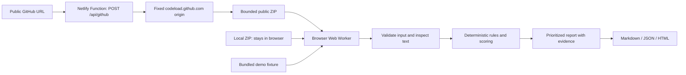

<div align="center">
  
  <h1>RepoSentinel</h1>
  <p><strong>Repository health. Inspectable evidence. Zero API keys.</strong></p>
  <p>Understand what needs attention before you install or run an unfamiliar codebase.</p>
  <p>
    <a href="https://reposentinel.netlify.app/"><strong>Launch the live demo ↗</strong></a>
    &nbsp; · &nbsp;
    <a href="https://github.com/Gyan987/RepoSentinel">Explore the source</a>
    &nbsp; · &nbsp;
    <a href="#try-it-in-60-seconds">60-second walkthrough</a>
  </p>
  <p>
    <a href="https://github.com/Gyan987/RepoSentinel/actions/workflows/ci.yml"></a>
    <a href="LICENSE"></a>
    
    
  </p>
  <p><sub>OmniRush Agentic Buildathon 2026 · Developer Tools &amp; Open Source</sub></p>
</div>

---

**A repository can look polished and still be difficult to evaluate.** Setup instructions may be missing, dependencies may float, and a small module can hide a circular import. New contributors need a clear starting point—not another unexplained score.

RepoSentinel turns a **public GitHub URL or a local ZIP** into a prioritized health report across documentation, tests, secret hygiene, dependencies, structure, and architecture. Findings include their reason, evidence, location when available, and a recommended next step.

> **No API key. No sign-in. No repository write access.** The deployed app runs deterministic TypeScript checks—not AI inference. OmniRush.ai was used to build and verify the project.

|                6 review categories                |         3 export formats          |   2 repository input modes    |
| :-----------------------------------------------: | :-------------------------------: | :---------------------------: |
| One prioritized view of repository-health signals | Markdown · JSON · standalone HTML | Public GitHub URL · local ZIP |

[Try the demo](#try-it-in-60-seconds) · [Why RepoSentinel](#why-reposentinel) · [Checks](#what-is-checked) · [Architecture](#architecture) · [Run locally](#quick-start) · [Tests](#testing) · [OmniRush workflow](#omnirush-usage) · [Limitations](#known-limitations)

## Try it in 60 seconds

1. Open **[reposentinel.netlify.app](https://reposentinel.netlify.app/)**.
2. Select **Try the bundled demo**—no account, ZIP, or API key needed.
3. Find the missing-test, missing-lockfile, and circular-import signals. Inspect their evidence and file locations.
4. Filter the findings by category, then download the full report as **Markdown**, **JSON**, or **HTML**.
5. Try a real public repository, such as `https://github.com/octocat/Hello-World`, or upload a small source-only ZIP.

The bundled demo runs the actual analyzers against an intentionally imperfect fixture. It is not a canned report. The first visit still needs the site assets; subsequent demo analysis does not make a repository network request.

## Why RepoSentinel?

**A practical first pass for contributors, maintainers, and code reviewers.** It brings several repository-level signals into one inspectable handoff without installing or executing the project being reviewed.

| Engineering choice                | Why it matters                                                                                                                         |
| --------------------------------- | -------------------------------------------------------------------------------------------------------------------------------------- |
| **Evidence before explanation**   | Findings identify the matched signal and location where available; repository-wide omissions do not invent a line number.              |
| **Local ZIP analysis**            | ZIP contents are processed in a browser worker, not uploaded to the application server.                                                |
| **Deterministic rules**           | The same inputs and fixed timestamp produce the same report; no model prompts or AI-service credentials are involved at runtime.       |
| **Portable results**              | Markdown fits a review, JSON fits downstream tooling, and standalone HTML makes a readable, printable handoff.                         |
| **Bounded, read-only inspection** | Archive limits, path validation, and a fixed GitHub download origin reduce the attack surface. Inspected code is never executed.       |
| **Reproducible engineering**      | Exact-pinned direct dependencies, a lockfile, regression tests, CI, and Netlify configuration make the implementation inspectable too. |

**Scope matters:** RepoSentinel complements linters, vulnerability scanners, tests, and human review. Its health score is a prioritization heuristic—not a security certificate or a measurement of test coverage.

## Usage

### Public GitHub repository

1. Select **GitHub URL**.
2. Enter a root URL such as `https://github.com/octocat/Hello-World` (a trailing `.git` is accepted).
3. Select **Analyze repository**. The endpoint reads the public default-branch ZIP from GitHub's codeload host, and your browser analyzes its contents in a worker.
4. Review the health score, category scores, and severity/confidence-ordered findings. Filter by category or high priority.
5. Download **Markdown**, **JSON**, or a self-contained, print-friendly **HTML** report. Exports include the complete report regardless of the current UI filter. HTML exports escape repository-provided text and use no scripts or external assets.

Only HTTPS `github.com`/`www.github.com` root repository URLs are accepted. Branch/file URLs, credentials, arbitrary hosts, queries, and fragments are rejected. A private, missing, or empty repository produces a readable error. No login or GitHub token is requested.

### Upload a ZIP

Select **Upload ZIP**, browse for a `.zip` or drop one into the upload area, then select **Analyze ZIP**. Create a source-only ZIP rather than including installed dependencies or build output. A single enclosing directory is removed when it encloses the entire repository; GitHub's Download ZIP layout is supported.

**Uploaded ZIPs stay in the browser.** The application sends no ZIP contents to its server. Files are read in memory, not extracted to disk. Selected repositories are never installed, built, imported, or executed.

### Demo

Select **Try the bundled demo**. The bundled `pocket-tasks` fixture has intentionally incomplete docs, no tests/lockfile, a floating dependency, and a static import cycle. It runs through the actual analyzers without a network request. The physical `environment.example.txt` fixture is presented to the analyzer as `.env.example`; this avoids exposing environment files through Vite's dev server.

The demo does not contain a real credential. It demonstrates actual static findings rather than a precomputed or AI-generated report. A first visit still needs the application assets; the app does not install an offline service worker.

## What is checked

| Category          | Deterministic signals                                                                                                                                                                                                                                     |
| ----------------- | --------------------------------------------------------------------------------------------------------------------------------------------------------------------------------------------------------------------------------------------------------- |
| Documentation     | Root README presence/length; setup wording or commands; missing relative Markdown link targets; conventional root license file                                                                                                                            |
| Tests & CI        | Conventional test paths and filenames; Rust inline test markers; non-placeholder npm test scripts; conventional GitHub/GitLab/Azure/Jenkins/CircleCI configuration paths                                                                                  |
| Secret hygiene    | GitHub/Slack token signatures, AWS access key IDs, Google API key-like strings, private key headers, credential-bearing HTTP URLs, generic hardcoded credential assignments, non-placeholder `.env` assignments, remote-download-to-shell package scripts |
| Dependencies      | Recognized ecosystem manifests; strict `package.json` parsing; npm-style lockfile presence; wildcard/moving/open-ended versions; bare Python requirements                                                                                                 |
| Project structure | Root `.gitignore`; recognized source files; explicit skipped-file accounting                                                                                                                                                                              |
| Architecture      | Source modules above 400 non-empty lines; more than 20 static import targets; cycles in resolvable relative JS/TS static imports                                                                                                                          |

Every finding answers three questions: **What was detected? Where is the evidence? What should I do next?**

Each finding includes a rule/instance ID, category, severity (`critical`, `high`, `medium`, `low`, `info`), confidence (0–1), title, explanation, path/line when available, evidence, and a recommendation. Instance IDs incorporate the rule, path, and line; they are not persistent tracking IDs across code changes. Confidence is a rule-assigned heuristic, not a calibrated accuracy estimate or the probability that a vulnerability is exploitable.

Recognized manifests include npm, Python, Rust, Go, Ruby, JVM, PHP, Dart, .NET, Elixir, and Deno conventions. Detailed dependency checks currently cover npm and `requirements*.txt`; presence recognition for another ecosystem is not a dependency audit. Recognized source extensions and ignored directory names are maintained in `src/core/archive.ts` and `src/core/analyze.ts`.

Secret findings redact matched values from their evidence and exports. Source contents are not embedded in reports. Placeholder patterns are suppressed; fixture/example signatures use lower confidence/severity. Confirm findings locally and rotate any genuinely exposed credentials. Detection does not validate credentials or contact their issuing services.

### Health score

The score is transparent and inspectable: it combines category weights, severity, and rule-assigned confidence. It is not an AI-generated grade.

<details>
<summary><strong>Expand the scoring policy</strong></summary>

Each category starts at 100. Severity penalties are **70 critical / 38 high / 20 medium / 8 low / 0 info**, multiplied by confidence. Repeated instances of one rule cost at most twice that rule's largest single penalty. Category scores are clamped to 0–100 and rounded.

Overall weights: **secret hygiene 30%, documentation 20%, tests 20%, dependencies 15%, structure 10%, architecture 5%**. The weighted score is rounded. Any critical finding caps the overall score at **49**; any high finding caps it at **79**. Findings are prioritized by severity, descending confidence, rule ID, file path, and line. Identical content and a fixed timestamp produce the same report.

This score is a prioritization heuristic, **not a security certification**. A clean report means the configured static checks did not find a signal, not that a repository is safe or well tested.

Read the implementation in [`src/core/scoring.ts`](src/core/scoring.ts).

</details>

## Architecture



- **React + Vite + TypeScript:** a focused UI with no application accounts or database.
- **fflate:** raw deflate support. RepoSentinel validates ZIP metadata first, inflates inspected entries in small compressed chunks, counts actual output, and verifies their CRC32.
- **`src/core/`:** portable input validation, snapshots, analyzers, scoring, report types, exports, and shared bounded response reader.
- **`src/analysis.worker.ts` + `src/client.ts`:** keep decompression/rules off the main UI thread; terminating a worker cancels analysis and frees its memory.
- **`src/server/github.ts`:** shared request handler with an injectable fetch boundary for tests. Only the fixed, validated codeload URL is fetched, redirects are refused, responses are bounded, and the fetch/body read has a 15-second deadline.
- **`netlify/functions/github.ts`:** Netlify v2 `Request`/`Response` function adapter. No Netlify SDK dependency is needed.
- **`vite.config.ts`:** attaches the same handler to development and preview servers at `/api/github`.

### Project map

| Location                                           | Responsibility                                                                      |
| -------------------------------------------------- | ----------------------------------------------------------------------------------- |
| [`src/App.tsx`](src/App.tsx)                       | Input modes, analysis state, report filters, and export controls                    |
| [`src/core/`](src/core/)                           | Archive policy, deterministic checks, score calculation, report schema, and exports |
| [`src/analysis.worker.ts`](src/analysis.worker.ts) | Analysis off the main UI thread                                                     |
| [`src/server/github.ts`](src/server/github.ts)     | Allowlisted, bounded public GitHub downloads                                        |
| [`netlify/`](netlify/)                             | Serverless adapter for the deployed application                                     |
| [`fixtures/demo/`](fixtures/demo/)                 | Intentionally imperfect, inspectable sample repository                              |
| [`tests/`](tests/)                                 | Unit, endpoint, export, and UI-integration regression checks                        |

## Privacy and input safety

| Input             | What reaches the application server?                           | Where is analysis performed? |
| ----------------- | -------------------------------------------------------------- | ---------------------------- |
| Public GitHub URL | The URL; the function downloads and returns its public archive | Browser worker               |
| Local ZIP         | No ZIP contents                                                | Browser worker               |
| Bundled demo      | No repository request; fixture ships with site assets          | Browser worker               |

The application has no persistence. Reports and repository text exist in the current browser session until replaced/reloaded. GitHub archives pass through the function in memory. The app sets no-store response headers and does not add request/body logging or application telemetry. Hosting-provider access logs/tooling and GitHub's public download availability are outside these application guarantees.

### Limits and input policy

| Boundary                           | Limit                                                |
| ---------------------------------- | ---------------------------------------------------- |
| Compressed ZIP / GitHub response   | 4 MiB                                                |
| Total declared expanded ZIP data   | 20 MiB                                               |
| ZIP entries, including directories | 2,000                                                |
| One inspected text file            | 512 KiB                                              |
| Archive path                       | 240 characters                                       |
| Function JSON request              | 2,048 bytes                                          |
| GitHub fetch + response body       | 15 seconds                                           |
| Findings retained                  | 500 highest priority, with a visible truncation note |

The 4 MiB download cap leaves room for binary response overhead on buffered serverless platforms. Files above 512 KiB, unsupported extensions, binary/non-UTF-8 text, and generated/vendor directories are skipped. Their safe paths remain available for presence/link checks and the UI reports how many files were omitted.

Traversal, absolute/drive/backslash/control-character paths, duplicate entries, symlinks, overlapping data, inconsistent headers, encryption, multi-volume archives, ZIP64, and unsupported compression methods are rejected. ZIP file names must be UTF-8 or ASCII; methods 0 (stored) and 8 (deflate) are supported. Checksums and actual expanded sizes are verified for inspected entries; ignored/binary entries are not inflated. Archive contents never reach the filesystem.

## Quick start

**Prerequisites:** Node.js **24 LTS** and npm. Node 22.12+ within the 22.x line is also supported.

```sh
git clone https://github.com/Gyan987/RepoSentinel.git
cd RepoSentinel
npm ci
npm run dev
```

Open the URL printed by Vite, normally **http://127.0.0.1:5173**. Both ZIP analysis and the local public-GitHub endpoint work with this command. No environment variables, Netlify CLI, or AI-provider setup are needed to run the app locally.

**One command to install, test, and build:**

```sh
npm ci && npm test && npm run build
```

All direct dependencies are exact-pinned; [`package-lock.json`](package-lock.json) records transitive versions and integrity hashes. Use `npm ci` for reproducible installation.

| Command              | Purpose                                                                          |
| -------------------- | -------------------------------------------------------------------------------- |
| `npm run dev`        | Local development with the GitHub endpoint                                       |
| `npm test`           | Offline unit, endpoint, export, and React integration tests                      |
| `npm run typecheck`  | Strict TypeScript checks, including the function and tests                       |
| `npm run build`      | Typecheck and optimized site/worker output in `dist/`                            |
| `npm run preview`    | Built site plus local GitHub endpoint, normally port 4173                        |
| `npm run test:watch` | Interactive test runner                                                          |
| `npm run smoke`      | After build: production preview, real public GitHub download, and emitted worker |

## Testing

**Reproducible checks, not unverified performance claims.** The latest local validation recorded **88 passing tests across 7 test files**, a passing production build/typecheck, and a passing network-enabled production-worker smoke test. This is a verification snapshot, not a claim that hosted browser interactions or the Docker image were tested.

Tests run locally without network access. Endpoint tests inject synthetic public archive responses instead of relying on GitHub availability. The CI badge at the top links to the repository's current workflow status.

<details>
<summary><strong>Explore the regression-test coverage</strong></summary>

- `tests/github-url.test.ts`: canonicalization, malicious origins, credentials, ports, encoded paths, root-only policy.
- `tests/archive.test.ts`: wrappers, traversal, malformed headers, compressed/expanded/entry limits, false expansion metadata, checksum corruption, symlinks/encryption/ZIP64/compression rejection, oversized/generated/binary files, direct-input validation.
- `tests/analyze.test.ts`: clean/incomplete fixtures, documentation/link evidence, test detection, manifests/lockfiles, secret redaction, shell pipelines, cycles, large modules, fanout, deterministic ordering, demo, export escaping.
- `tests/export.test.ts`: complete standalone HTML reports, script/markup injection escaping, optional fields, and Markdown/JSON/HTML download contents, filenames, MIME types, and object-URL cleanup.
- `tests/scoring.test.ts`: weights/confidence, severity ceilings, repetition caps, score bounds, priority order.
- `tests/server.test.ts`: endpoint contract, Netlify adapter, fixed outbound target, bounded streaming, timeout/cancellation, safe upstream error mapping.
- `tests/app.test.tsx`: actual demo and ZIP-to-report smoke paths, public-URL-to-report integration, category filters, downloads, invalid input, file drop, loading and cancellation. jsdom substitutes a direct analyzer for browser Worker transport; the actual ZIP parser/rules/scorer run in these tests.

</details>

The normal build typechecks the UI, worker, shared core, local middleware, Netlify function, and tests. There is no separate lint configuration. Automated tests do not run an installed real browser or deploy to Netlify.

`npm run smoke` is an optional network-enabled integration check after `npm run build`. It starts production preview on `127.0.0.1:4175`, checks the served site/worker and invalid-URL response, reads `octocat/Hello-World` through the real local endpoint, and sends that ZIP through the actual emitted analysis-worker bundle using a Node worker transport adapter. It closes the server/worker afterward. This check depends on GitHub availability and makes no authenticated requests. `npm test` remains entirely offline.

## Deploy to Netlify

**Live application: [https://reposentinel.netlify.app/](https://reposentinel.netlify.app/)**

To reproduce the deployment:

1. Publish this repository to your GitHub account when ready.
2. In Netlify, import the repository as a new site.
3. Keep the repository root as the base directory. `netlify.toml` supplies:
   - Build: `npm run build`
   - Publish: `dist`
   - Node: `24`
   - Functions: `netlify/functions`, bundled with esbuild
4. Deploy. There are **no environment variables or secrets to configure**.
5. On the deployed site, run the bundled demo, upload a small ZIP, and submit a small public GitHub repository URL. Confirm `/api/github` returns a ZIP for a valid POST and a JSON error for invalid input.

The `/api/github` rewrite reaches `/.netlify/functions/github`. Netlify serves the static UI/worker assets and the function. Security headers include a self-only content security policy; inline style attributes are allowed for score indicators. The function requires outbound HTTPS access to `codeload.github.com`.

For manual deployment, deploy **both** `dist` and the function using Netlify's normal repository/CLI workflow. Drag-and-drop of only `dist` does not create the GitHub endpoint; ZIP/demo still work on static hosting. Importing/deploying the repository on Netlify requires your own hosting authorization, but running the app never requests repository write access. No hosting deployment is performed by the implementation scripts.

### Docker

```sh
docker build -t reposentinel .
docker run --rm -p 4173:4173 reposentinel
```

Open `http://localhost:4173`. The multi-stage image builds the site, runs as the unprivileged Node user, and serves production assets with Vite preview plus the shared GitHub middleware. It deliberately retains build tooling for that middleware; Netlify is the primary deployment target. No credentials or repository mount are needed. The Docker build requires npm registry access. The Docker image is not a hardened, high-scale production server.

**Verification boundary:** the Dockerfile is provided, but image build/run was not verified in the recorded local checks because a running Docker daemon was unavailable.

## CI

`.github/workflows/ci.yml` runs `npm ci`, `npm test`, and `npm run build` on pushes and pull requests with read-only repository permissions. It does not deploy or require secrets. Dependency installation for developing/building RepoSentinel uses npm; repository analysis itself only makes the optional public GitHub read.

## OmniRush usage

### Built with OmniRush. Independently runnable.

OmniRush.ai was used as the development environment and agent tool—not as a hidden production dependency. Implementation work was delegated to scoped sub-agents, then reviewed and integrated in the main session.

| Development workstream       | Actual contribution                                                                                       | Inspectable evidence                                                                       |
| ---------------------------- | --------------------------------------------------------------------------------------------------------- | ------------------------------------------------------------------------------------------ |
| Application implementation   | Input flows, browser-worker analysis, deterministic rules, scoring, Netlify adapter, and regression tests | [`src/`](src/), [`netlify/`](netlify/), [`tests/`](tests/)                                 |
| Scoped export implementation | Standalone, escaped HTML reports alongside Markdown/JSON, with focused export/UI tests                    | [`src/core/export.ts`](src/core/export.ts), [`tests/export.test.ts`](tests/export.test.ts) |
| Main-session integration     | Code review, combined test/build checks, and public-GitHub production-worker smoke checks                 | [Testing commands](#testing), [`scripts/smoke.mjs`](scripts/smoke.mjs)                     |

The deployed application runs **deterministic static checks, not autonomous AI agents**. It needs no OmniRush account, model access, or AI API key for a user to analyze a repository. The retained OmniRush sessions document the real development process; private transcripts and credentials are not copied into this repository.

Open this folder as the workspace in **OmniRush.ai** and use its terminal/tools to run the documented npm commands. RepoSentinel has no OmniRush runtime dependency and needs no OmniRush/AI API key to function.

Useful prompts for extending the project:

- “Run RepoSentinel's tests and production build; explain any failures.”
- “Add a deterministic rule with file/line evidence and a focused regression test.”
- “Review the ZIP limits and endpoint URL allowlist without changing behavior.”

When extending a check, work through `src/core/`, preserve redacted evidence, update the score policy documentation if needed, and verify the demo/upload flows. Run `npm test` and `npm run build` before reviewing a change. Ask explicitly before committing, pushing, or deploying; none of those actions is part of the app.

## Suggested demo recording

**Tell a concrete story in 2–3 minutes: “What should I inspect before contributing to this repository?”**

| Scene             | Show                                                                                       | Explain                                                                                                |
| ----------------- | ------------------------------------------------------------------------------------------ | ------------------------------------------------------------------------------------------------------ |
| The problem       | The live site and its input options                                                        | First-pass repository review should not require running unfamiliar code or configuring an AI provider. |
| The evidence      | Run the bundled demo; inspect a missing-test signal, missing lockfile, and circular import | Findings come from actual files and rules, not a prewritten report.                                    |
| A real repository | Analyze `https://github.com/octocat/Hello-World`                                           | Public archives pass through an allowlisted function and are analyzed in the browser.                  |
| The local path    | Upload a small source-only ZIP; show inspected/skipped counts                              | ZIP contents stay in the browser, with explicit size and format limits.                                |
| The handoff       | Filter findings; export Markdown, JSON, and HTML                                           | Results are portable, evidence-backed, and useful for a subsequent human review.                       |
| The engineering   | Show the tests, build, source, and actual OmniRush development session                     | The implementation is reproducible; the limitations and development process are inspectable.           |

Record real interactions and actual command results. Do not display account settings, credentials, or private files; do not present the heuristic score as a security guarantee.

## Known limitations

**This is a bounded first-pass review, not a replacement for executing your tests, a vulnerability database, or expert security review.**

<details>
<summary><strong>Read the analysis and platform boundaries</strong></summary>

- Static heuristics can produce false positives/negatives. Tests/CI are detected, never executed; a present test file does not prove coverage or correctness.
- No CVE/advisory lookup, dependency installation, full syntax/type analysis, Git history analysis, credential validation, or AI inference. Common secret patterns are supported, not every credential format or encoding.
- Import-cycle analysis covers recognized static relative JS/TS imports, including type-only imports. Aliases, dynamic imports, package boundaries, and other languages are not fully resolved; type-only cycles and barrels can be harmless.
- Documentation link parsing is intentionally basic Markdown, without generated routes, reference-style links, anchor validation, or remote HTTP checks. Setup wording is English-oriented.
- Skipped, oversized, binary, generated, non-UTF-8, or unsupported files reduce coverage. Presence and absence are interpreted using available safe archive paths and visible notes. An all-unsupported archive is rejected.
- Large/ZIP64/encrypted/nonstandard archives are rejected. A single enclosing folder is treated as a repository wrapper; very minimal archives with only one top-level directory can therefore have paths shortened.
- GitHub input reads only the public default branch. Availability, rate limits, empty repositories, and the 4 MiB cap can prevent remote analysis; a smaller source-only ZIP is the local fallback. Git LFS pointers/submodule links are not expanded.
- No server-side history, accounts, sharing links, scheduled monitoring, or automatic repository changes. Reports are downloaded explicitly by the person using the app.
- The public function is resource-bounded but has no distributed per-user rate limiter. Use the hosting platform's traffic controls if publishing to a high-traffic audience.

</details>

## License

Open source under the **[MIT License](LICENSE)**.

---

<div align="center">
  <strong>Inspect the signals. Understand the evidence. Make the next change deliberately.</strong><br />
  <a href="https://reposentinel.netlify.app/">Try RepoSentinel live ↗</a>
</div>
